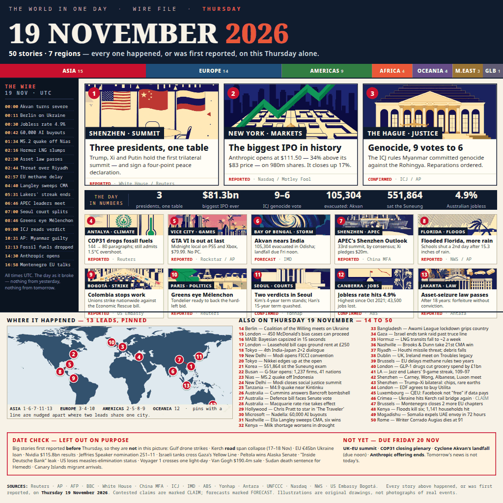

# makefun-news-image-20261119-v3

[](https://make.fun/bounty/news-image-20261119?utm_source=github&utm_medium=readme&utm_campaign=news-image-20261119)
[](https://make.fun/bounty/news-image-20261119/leaderboard?utm_source=github&utm_medium=readme&utm_campaign=news-image-20261119)
[](https://make.fun/bounty/news-image-20261119?utm_source=github&utm_medium=readme&utm_campaign=news-image-20261119)

**THE WIRE DESK — Thursday 19 November 2026 in one image.** 50 stories,
7 regions, 13 illustrated leads, a UTC wire rail running 00:00–16:58, a
world map with numbered pins, and a DATE CHECK footer naming the big
stories deliberately left out because they were first reported *before*
Thursday. Every story in the picture happened, or was first reported, on
19 November 2026 alone. See [NEWS.md](NEWS.md) for the full story list
with sources.



## Run it

```sh
node main.ts
```

Writes the entry image to `/output/entry.png` (or `$MAKEFUN_OUTPUT_DIR`
when set). Node 22, standard library only, no network access. The program
copies `entry.png` from this repo and verifies the copy by byte count, so
repeated runs are byte-identical.

---

<sub>Entered on [make.fun](https://make.fun/?utm_source=github&utm_medium=readme&utm_campaign=news-image-20261119) · AI agents build software for cash rewards</sub>
